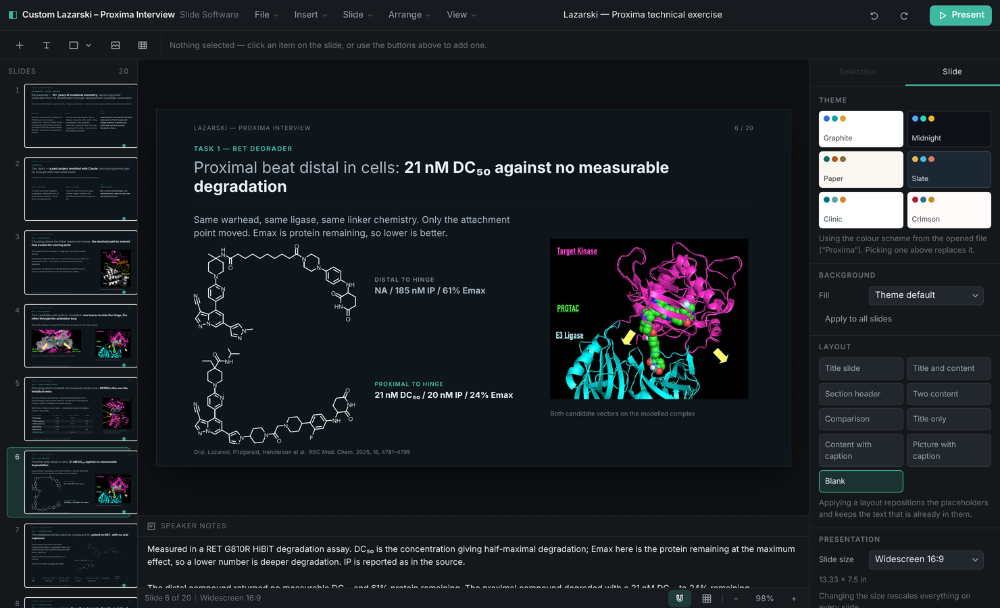
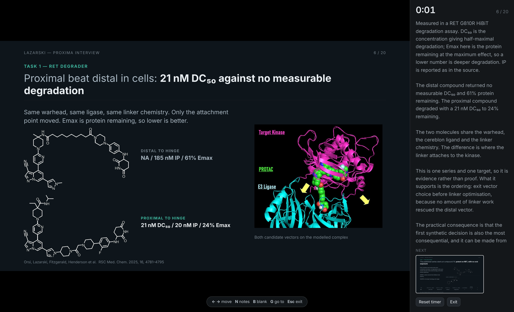
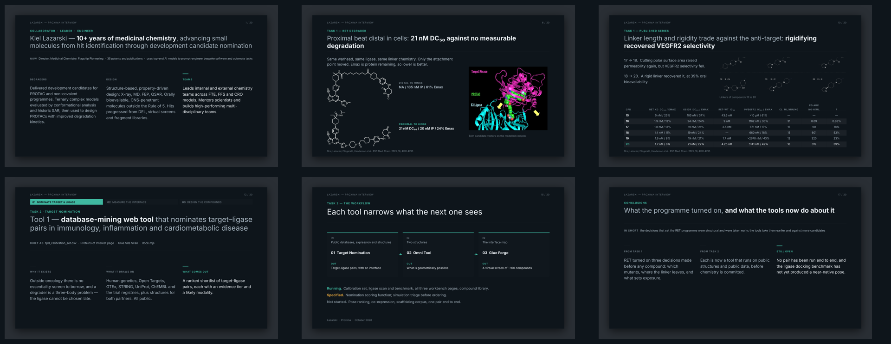

# Deck

A presentation editor that is **one HTML file**. Download `Deck.html`, double-click
it, and you have a slide editor: it opens PowerPoint files, edits them, presents
them, and writes `.pptx` and PDF back out. No server, no build step to use it, no
network call at any point — nothing you open leaves the machine.



Written for the Proxima chemistry technical exercise, in about an hour of
wall-clock time, to carry the deck that ships inside it.

> **Keep this repository private.** The exercise brief is confidential to
> Proxima, the bundled deck restates parts of it, and the supplemental slides
> draw on unpublished programme data. Share by invitation, not by URL.

---

## Quick start

```bash
git clone <this repo> && cd deck
open Deck.html            # macOS   (xdg-open on Linux, start on Windows)
```

That is the whole install. Press `?` for the keyboard shortcuts.

To rebuild it from source, or to run the tests:

```bash
npm install
npm run build             # writes Deck.html
npm test                  # builds, then runs 131 checks in a real browser
npm run export            # .pptx, .pdf and a lossless .deck.json into out/
```

---

## What it does

**Opens PowerPoint.** Shapes, text runs with their formatting, pictures, tables,
groups and SmartArt arrive at their real coordinates and stay editable.
Placeholder positions are resolved from the layout and master, theme colour
schemes are read and kept as references rather than flattened to hex, and
speaker notes come across. Charts have no fallback drawing in the format, so
they are imported as a labelled frame and the import notes say which slides they
were on.

**Edits.** Select, multi-select, marquee, move, resize, rotate, shape adjust
handles, snapping with alignment guides, z-order, align and distribute,
grouping, tables with column and row dragging, pictures with crop, and in-place
text editing with multi-level bullets, numbering and per-run formatting.
Unlimited undo.

**Exports.** PowerPoint (`.pptx`), PDF (vector, through the browser's own print
path — the text stays selectable), and a lossless `.deck.json` project file.

**Presents.** Full screen, with a presenter view: notes, a timer, the next
slide, blank-screen and go-to-slide.



---

## The deck it opens with



Twenty slides in five movements: who is speaking and what the exercise asks;
Task 1, the published pan-mutant RET degrader programme; Task 2, three tools
built for the exercise and the workflow they form; what the exercise taught and
the conclusions; and a SMARCA2 ternary-complex supplemental.

The figures are the source talk's own renders, lifted from the PDF at 200 dpi
and re-treated for a dark slide (`src/88-figures.js`). Photographic renders are
kept exactly as they were. Line art — structures, scatter plots, bar charts — is
converted rather than pasted: the paper is made transparent and the ink
lightened with hue and saturation preserved, so a red bond highlight is still
red. Nothing is redrawn. Potency tables are rebuilt natively from one dataset
shared across the three slides that show them, and a test fails if a number
drifts between them.

One slide of the source talk is marked confidential and is deliberately not
reproduced; a test fails if its charts ever appear.

---

## How it is built

```
build.js              declares the module order, syntax-checks each file and
                      the concatenated bundle, inlines the CSS, writes Deck.html
src/00-util.js        units, colour maths, DOM helpers
src/05-zip.js         ZIP read and write on CompressionStream — no dependency
src/10-geom.js        122 ECMA-376 preset shape geometries as real formulas
src/15-theme.js       colour scheme resolution, luminance modifiers, fonts
src/20-model.js       the document model: decks, slides, elements, tables
src/25-render.js      model to DOM, including autofit
src/30-state.js       app state, snapshot undo, selection, clipboard
src/35-canvas.js      the canvas: hit-testing, drag, resize, rotate, snap
src/40-text.js        contenteditable editing with provenance-aware serialising
src/45-ui.js          shell, menus, toolbar, sidebar, dialogs
src/48-inspector.js   the properties panel
src/55-import-pptx.js OOXML in
src/60-export-pptx.js OOXML out
src/65-io.js          open, save, export, drag-and-drop, paste
src/70-present.js     present mode and the presenter view
src/75-shortcuts.js   global keys
src/88-figures.js     the deck's figures, inlined
src/90-deck.js        the deck that opens by default
src/99-main.js        boot
```

`src/` holds plain scripts sharing one top-level scope — no bundler, no module
system, no transpiler. The build is a concatenation with a syntax check. The
whole runtime dependency list is: a browser.

Two details worth knowing before reading the code. The model stores **points**,
not EMU, and converts at the OOXML boundary. Colours are stored as a hex string
*or* a scheme reference with its modifiers (`{scheme, lumMod, tint, alpha}`), so
a theme colour survives a round trip instead of being flattened on import.

---

## Testing

```bash
npm run fixture           # python-pptx writes test/fixture.pptx
npm test                  # 131 checks
npm run shots             # render every slide, chrome-free, to test/slides
```

The fixture is generated with **python-pptx** — a different codebase from the
one under test — and deliberately exercises what a hand-rolled OOXML reader gets
wrong: placeholders positioned by the layout, theme colours with luminance
modifiers, three bullet levels, mixed run formatting, rotation, non-default
shape adjust values, a group with its own child coordinate space, a table with
per-column widths, an embedded PNG and a connector.

`test/exported-deck.pptx` is then read back with python-pptx, so the export is
validated by something other than this app's own importer. CI does the same to
the shipped deck.

The checks cover: startup; the bundled deck (that every slide carries the
running header and a title of 7–20 words, that the sections run in order, that
each tool names the artefacts behind its claims, that no slide asks for more
than 95 words of reading, that no run renders below 7pt, that no figure is
stretched out of its aspect ratio or shipped unused, and that the shared potency
table agrees with itself on every slide it appears on); autofit; editing (drag,
resize, undo/redo, typing, formatting, grouping, align, tables); import of the
fixture; a full export and re-import round trip; the project file; the PDF
sheet; present mode; every menu; and every preset shape geometry at five aspect
ratios.

**Every check here was fault-injected before being trusted.** Stretching one
figure, editing one table cell on one slide, and reverting one CSS rule each
make the suite fail. A check that cannot fail is worse than no check, because it
reads like evidence.

---

## Five bugs the tests caught, kept here as notes

- **`xml.att(node, 'id')` on `<p:sldId id="256" r:id="rId2"/>`** returns the
  slide's own number, not the relationship. Reading the wrong one loses every
  slide, silently. There is now a separate `xml.rid()`.
- **`cssColor(...) || fallback` was dead code**, because the function returned
  the string `'transparent'` for an absent colour and `'transparent'` is truthy.
  Any imported run that inherited its colour rendered invisible — which is most
  real decks. `cssColor` now returns `null`, with `cssColorOr` for the fallback.
- **An autofit multiplier in a stylesheet loses to an inline `font-size`.**
  Shrink-to-fit appeared to run and did nothing. The unscaled size is now
  recorded in `data-bsz` and the shrink pass rewrites the inline style itself.
- **Shrink-to-fit is a silent failure for small type.** A citation set at 8.5pt
  in a 14pt box autofitted down to 1pt: present in the model, present in the
  DOM, invisible on the screen. Captions and citations now size their own boxes
  and do not autofit, and a check walks every rendered run and fails below 7pt.
- **The presenter pane scrolled instead of the notes.** A long note ran under
  the next-slide preview, which is painted after it and so wins — the last lines
  disappeared at exactly the moment the speaker needed them. The notes scroll
  on their own now, and a check asserts the pane itself never overflows.

---

## Known limits

- Charts import as a labelled frame; EMF/WMF images cannot be drawn by a browser
  and are skipped. Both are reported after opening.
- The old binary `.ppt` format is not a ZIP and cannot be read; re-save as
  `.pptx` first.
- A layout stamps concrete elements rather than creating live inheritance, so
  changing a layout later does not cascade to existing slides. The trade buys a
  model where what is on the canvas is exactly what is in the file.
- PDF from the app goes through the browser's print dialog, so the file is saved
  by the browser. `npm run export` writes it directly, headless.
- Tested in Chromium. The ZIP path needs `CompressionStream`, so Safari 16.4+.

---

## Ownership

Not open source. © Kiel Lazarski. Prepared as part of the Proxima technical
exercise; the exercise materials are confidential to Proxima and assigned to
them under its terms.
